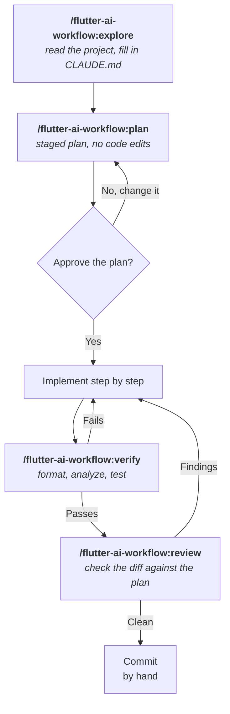

# flutter-ai-workflow

A Claude Code plugin with four skills for working on Flutter apps:
explore the project, plan in stages, verify, review.

**Status: v0.x. Early and still changing.** Skill behavior may change between commits.

## How to use it



Boxes starting with `/` are skills. The rest you or Claude do directly.
Run `explore` once per project. After that, start each task at `plan`.

| Skill | What it does |
|---|---|
| `explore` | Detects the stack from the code, asks only about gaps, and drafts a `CLAUDE.md` for you to confirm. |
| `plan` | Writes a plan with one stage per layer (repository, data, UI, routing) and waits for your approval. |
| `verify` | Runs the format, analyze, and test commands from your `CLAUDE.md` and reports the results. |
| `review` | Reports scope creep, missing states, convention breaks, and missing tests in the uncommitted diff. |

None of them assume a stack. They read your project's own `CLAUDE.md` and code.

## Install

```bash
claude plugin marketplace add nicolinx/flutter-ai-workflow
claude plugin install flutter-ai-workflow@flutter-ai-workflow
```

Then open your Flutter project in Claude Code and run `/flutter-ai-workflow:explore`.

A plugin cannot ship a `CLAUDE.md` that loads by itself, so `templates/CLAUDE.md` is a
template. `explore` fills it in with you, or you can copy it by hand.

## General practice vs. how I work

- **General practice:** explore before planning, plan before coding, run format, analyze, and tests, read the diff before committing.
- **How I work:** the stage order in `plan` (repository, data, UI, routing) and the code conventions in the template. Change them to fit your project.

## What has been tested

Run on small throwaway Flutter projects only.

- **`explore`:** with no `CLAUDE.md`, with `TODO` lines, and with a complete one. It asked questions only when something was missing.
- **`plan`:** wrote a four-stage plan and waited for approval. With an incomplete `CLAUDE.md` it asked first, and told me to run `explore` myself, because skills cannot call each other.
- **`verify`:** stopped at the first failing command, quoted the error, and changed no code.
- **`review`:** found each planted problem (unplanned file, missing states, debug print, no test) with file and line.
- **Install:** the commands above worked.

Not tested: large projects, long interactive sessions, Windows, Linux.
I have not measured any effect on speed or code quality.

## License

MIT. See [LICENSE](LICENSE).
